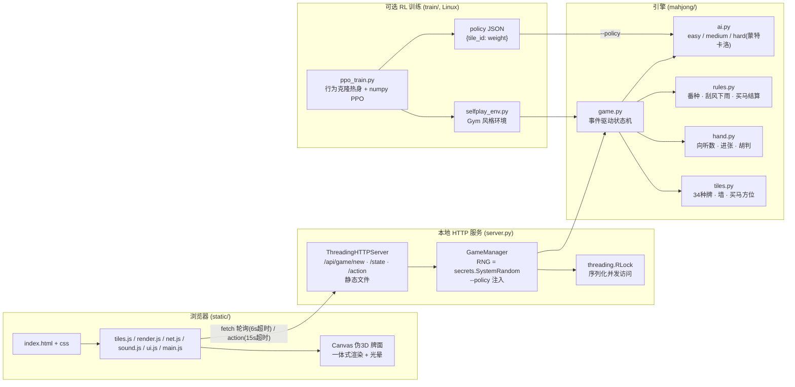

# 架构图 · ARCHITECTURE.md

## 数据流

1. **开局**：浏览器 POST `/api/game/new` → `GameManager.create()` 用系统加密随机洗牌发牌 → 返回 `{state, events, next_seq}`。`state.players[i]` 只含他人**手牌张数**与弃牌/副露，绝无他人手牌内容。
2. **轮询**：前端每 ~1s `GET /api/game/{gid}/state?since=seq`，服务端返回自 `seq` 以来的增量事件 + 最新快照；事件按 `seq` 递增在 Canvas 上回放（摸/打/吃碰杠/胡/买马/流局）。
3. **操作**：`POST /api/game/{gid}/action`（定缺/出牌/胡/杠/claim/next_round）。`human_action` 在 `with g.lock` 内执行，引擎 `_advance()` 自动推进 AI 直到需要人类输入或本局结束。
4. **AI 决策**：easy/medium 用向听+进张+危险度；hard 对每个候选弃牌做蒙特卡洛抽样推演（只读公共信息），`--policy` 注入的策略权重作为先验叠加进 logits。
5. **训练对接**：`train/selfplay_env.py` 把引擎包装成 Gym 风格环境（seat 0 出牌、缺门/claim 用固定启发），`ppo_train.py` 自对弈产出 `policy JSON` → 服务端 `--policy` 加载 → 影响 hard AI 的弃牌倾向。

## 关键不变式（测试保证）

- 牌数守恒：13×4 起手 + 墙 + 弃牌 + 副露 + 胡牌手牌 + 杠补 + 马牌 = 136（或 108），每局校验。
- 得分守恒：每局四家分数增量之和恒为 0。
- 信息隐藏：`public_snapshot()` 对非人类玩家只输出 `hand_count`。
- 并发安全：所有 `_pack` 与 action 处理都在 `Game.lock` 内，杜绝浏览器与驱动脚本并发读写错乱。
- 四川定缺：缺门牌必须优先打光、未清空前禁打其他花色（引擎 `_can_discard`、AI `_clear_absence`、前端拦截、渲染高亮四处一致）。
